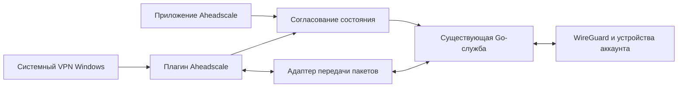

# Aheadscale в системном VPN Windows: проект первого этапа

Дата: 2026-10-19. Статус: проект для согласования, реализация не начата.
Основание — запрос добавить Aheadscale в раздел VPN Windows с полноценным
управлением. [Исследование API и текущего клиента](../../aheadscale/windows-vpn-research.md).

## Пользовательский результат

Пользователь устанавливает Aheadscale, входит через браузер и видит профиль
Aheadscale в «Параметры → Сеть и Интернет → VPN». Подключение и отключение
доступны из системного UI и приложения; состояние совпадает. Регистрация,
каталог устройств и доступ по приватным именам сохраняются. Системный профиль
создаётся автоматически, адрес сервера и XML пользователь не вводит.

## Решение, предлагаемое к согласованию

Выделить Windows VPN-плагин в подписанный пакет MSIX. Плагин реализует
`IVpnPlugIn`, а системный профиль связывается с его Package Family Name.
Текущая Go-служба сохраняет управление аккаунтом, каталогом, WireGuard и
обнаружением других устройств. Для соединения с Windows VPN необходим отдельный
адаптер передачи пакетов и управления жизненным циклом.

Это кандидат для технической проверки: совместимость обмена пакетами плагина
со службой и точная граница компонентов пока не доказаны. На первом этапе
проверяется жизнеспособность этого разделения; перенос всей Windows-реализации
до результата эксперимента не начинается.

В целевом режиме Windows VPN владеет системным L3-интерфейсом, а изменения
маршрутов и приватного DNS проходят через согласованную границу плагина.
Одновременная настройка одинаковых маршрутов двумя адаптерами исключается.
Для исходного режима `.8` сохраняется нынешнее поведение Wintun.

## Первый этап: проверка на ARM64 VM

1. Подготовить среду сборки с Windows SDK и C++/WinRT отдельно от пользовательской
   VM. Собирать пакет ARM64; Windows AMD64 подключить после доказательства подхода.
2. Собрать минимальный плагин на основе официального примера Microsoft,
   создать отдельный MSIX с тестовой идентичностью Aheadscale Prototype.
3. Подписать отдельным сертификатом разработки. До установки зафиксировать
   пакет, SHA256, публичный сертификат, отпечаток, порядок удаления и состояние
   существующего клиента. На VM доверять только этому тестовому сертификату
   в TrustedPeople; проверку подписей и защиту ОС не отключать.
4. Проверить регистрацию профиля, вызовы Connect/Disconnect и точный контекст
   запуска плагина. Доказать допустимый канал связи со службой. Для этого шага
   не ослаблять авторизацию действующего IPC и не добавлять общий незащищённый
   локальный управляющий порт.
5. Подключить обработку реальных пакетов через опытный вариант адаптера.
   Назначение адресов, маршрутов и DNS согласовать с Windows VPN API.
6. Проверить IPv4 HTTP по IP, полному и короткому имени в обе стороны с Ubuntu,
   управление из двух интерфейсов, остановку службы, восстановление и откат.
   После эксперимента очистить опытный профиль, пакет и доверие сертификату,
   оставить проверенную рабочую конфигурацию.

Успех промежуточного шага регистрации профиля не означает готовность сетевой
интеграции. Если безопасная связь или обработка пакетов невозможна в предложенной
схеме, результат этапа — доказанное ограничение и пересмотр архитектуры.
Производственная сборка на этот эксперимент не переключается.

## Состояния и ошибки

- Disconnected: намеренное отключение из приложения или Windows; повторное
  подключение не запускается автоматически вопреки этому действию.
- Connecting: канал запускается, необходимая регистрация выполняется через
  существующий браузерный вход. До завершения системный статус не становится
  Connected.
- Connected: канал и движок готовы к передаче трафика; отсутствие других
  устройств в аккаунте само по себе допустимо.
- Reconnecting: потеря связи обрабатывается согласованно; намеренное отключение
  отменяет восстановление.
- Failed: причина доступна пользователю, системный профиль не остаётся
  подключённым после остановки движка.

Приватные ключи остаются у службы. Плагину и профилю не передаются пароли,
refresh token и экспорт ключей устройства. Чужие профили VPN не изменяются.

## Критерии завершения первого этапа

| Проверка | Ожидание |
| --- | --- |
| Системный UI | Виден профиль Aheadscale, подключение запускает настоящий канал. |
| Согласование управления | Connect/Disconnect из Windows и приложения дают одинаковое состояние. |
| Первый вход | Открывается существующий браузерный поток; регистрация устройства не дублируется. |
| Сеть | HTTP по трём формам адреса проходит в обе стороны, получен правильный ответ другого устройства. |
| Приватный DNS | Работают полные и короткие имена, обычный интернет сохраняется. |
| Сбой службы | Системный статус отражает прекращение передачи, выводится понятная ошибка. |
| Повторный запуск | Повторный вход и ручная правка маршрутов не нужны. |
| Откат | Удалён опытный профиль, пакет и сертификат; действующий клиент сохраняет свою регистрацию. |

IPv6, оптимизация производительности, полный цикл обновлений, рабочая подпись
и автоматическая установка пакета в составе публичного установщика относятся
к следующему этапу после успешной проверки. Итоговый продукт по-прежнему должен
устанавливаться одним установщиком; отдельные ручные действия допустимы только
на операторской VM во время эксперимента.

## Альтернативы и границы

- Рекомендуемый кандидат: небольшой Windows-плагин и связь с текущим движком.
  Позволяет исследовать системный UI без немедленного переноса всей службы.
- Перенести движок внутрь пакетного VPN-компонента. Сильнее меняет модель
  привилегий, жизненный цикл и упаковку; рассматривать при доказанной
  непригодности взаимодействия с существующей службой.
- Оставить текущий Wintun-клиент и дать адаптеру имя Aheadscale. Это уменьшает
  объём работ для MVP, но само по себе не выполняет запрос о системном VPN UI.

Текущий публичный сервер, авторизация, бесплатный лимит устройств, Linux/macOS
и будущая конфигурация с CDN в этот этап не входят. Новый установщик пока не
публикуется. Работы ведутся одним агентом; обновление Windows для подготовки
прототипа не планируется.
